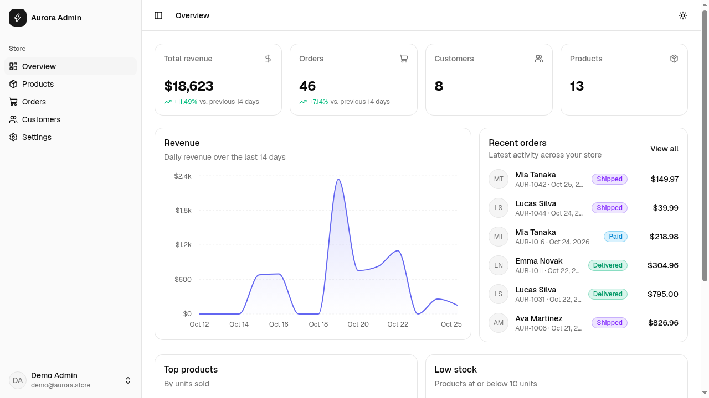
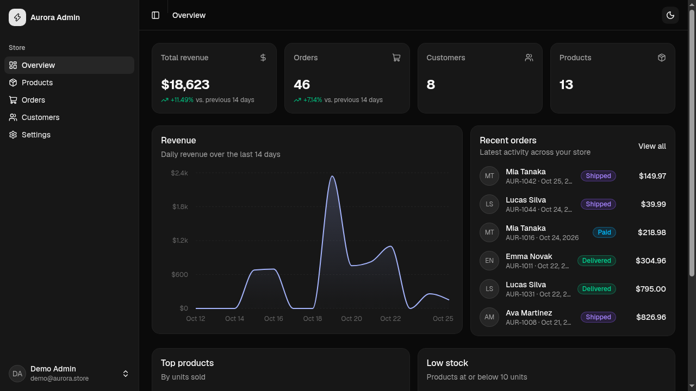
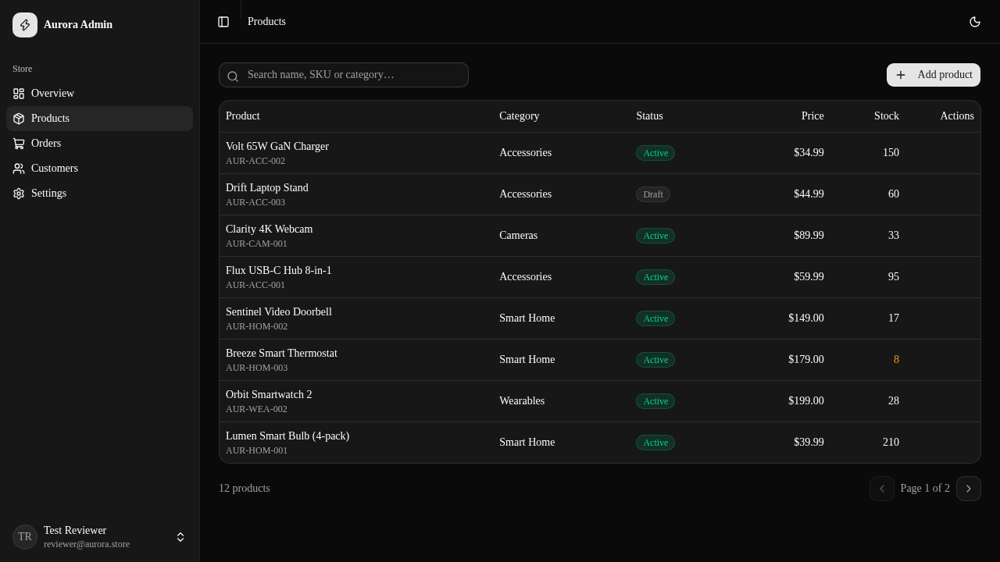
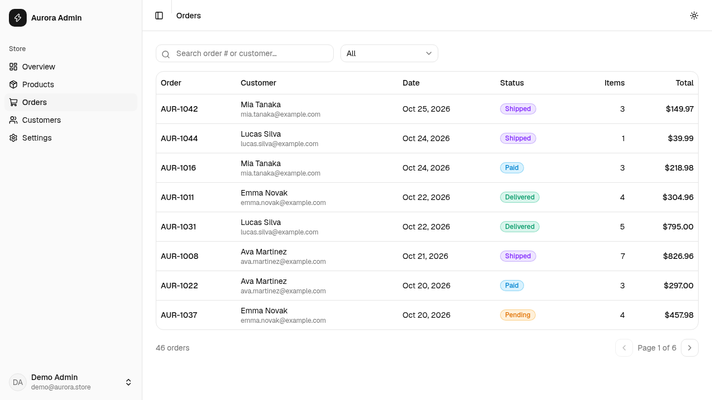
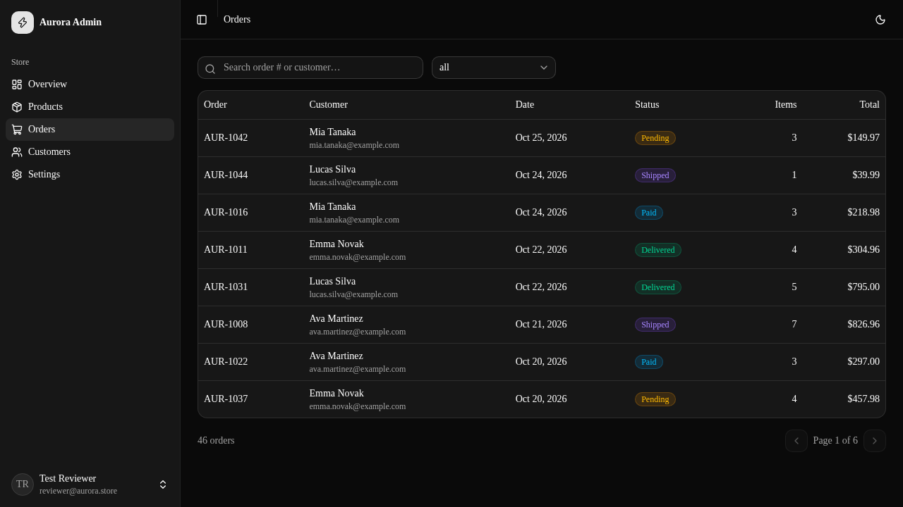
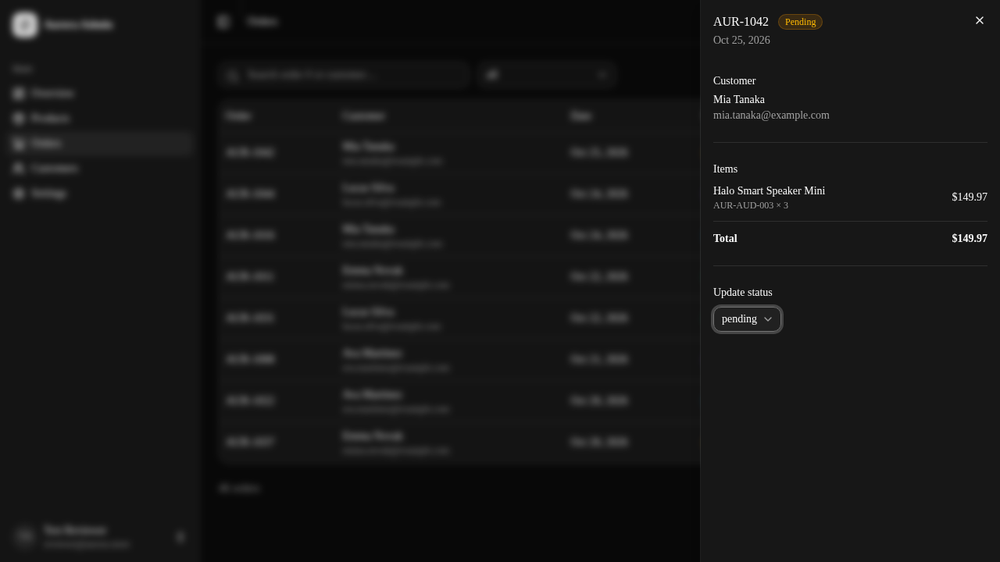
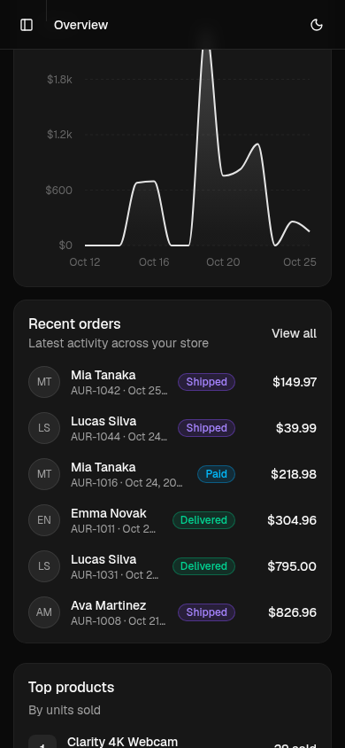
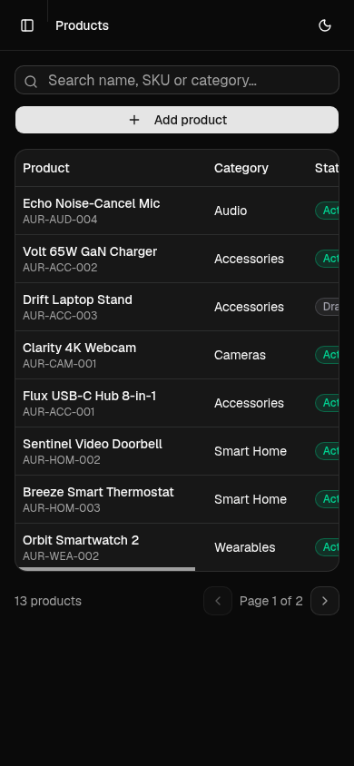

# Aurora Admin — Store Admin Dashboard

A full-stack admin dashboard for a demo e-commerce store ("Aurora"), with working
authentication (signup / login / logout), product management, order tracking, customer
insights and an analytics overview.

Built with **Next.js (App Router) + TypeScript + Tailwind CSS + shadcn/ui**, with a
**SQLite** database via **Prisma** so the project runs locally with zero external services.

## Features

- **Authentication**
  - Email + password signup and login
  - Passwords hashed with bcrypt (cost 12)
  - Sessions via signed JWT in an `httpOnly` cookie (7-day expiry)
  - Server-side route protection (dashboard layout + every API route checks the session)
  - Profile update and password change (current password re-verified)
- **Overview dashboard**
  - Revenue / orders / customers / products stat cards with period-over-period deltas
  - Daily revenue area chart (last 14 days)
  - Recent orders, top products by units sold, low-stock alerts
- **Products** — search, paginated table, create / edit via validated dialog forms,
  delete with a safeguard (products referenced by orders must be archived instead)
- **Orders** — search and status filter, paginated table, detail side-sheet with line
  items, inline status updates
- **Customers** — searchable list with order counts and lifetime spend
- **UI/UX** — dark / light theme toggle, collapsible sidebar, responsive layout,
  loading skeletons, toast feedback, debounced search
- **Testing** — unit tests for password hashing, session tokens, input validation and
  the dashboard statistics logic

## Tech stack

| Layer      | Choice                                             |
| ---------- | -------------------------------------------------- |
| Framework  | Next.js 16 (App Router, route handlers)            |
| Language   | TypeScript                                         |
| UI         | Tailwind CSS 4, shadcn/ui components, Base UI      |
| Charts     | Recharts (via shadcn/ui chart wrapper)             |
| Database   | SQLite through Prisma ORM                          |
| Auth       | bcryptjs + jose (JWT session cookie)               |
| Validation | zod (shared between client and server)             |
| Tests      | Vitest                                             |

> The assessment brief suggested "React with Vite, Node.js, Express, and MySQL" as a
> permitted stack. Next.js is used instead: it is React + Node.js with the API layer
> colocated (route handlers), and SQLite replaces MySQL so that anyone can run the
> project locally with a single command and no database server to install. The Prisma
> schema maps directly onto a MySQL datasource if one is preferred.

## Screenshots

| Dashboard (light) | Dashboard (dark) |
| --- | --- |
|  |  |

| Products (dark) | Orders (light) | Orders (dark) |
| --- | --- | --- |
|  |  |  |

| Order detail (dark) | Mobile dashboard | Mobile products |
| --- | --- | --- |
|  |  |  |

## Run locally

Requirements: Node.js 20+ and npm.

```bash
npm install
cp .env.example .env    # defaults work out of the box (SQLite file + dev secret)
npm run db:setup        # creates the database, runs migrations and seeds demo data
npm run dev             # http://localhost:3000
```

The seed creates a demo admin you can sign in with immediately:

```
Email:    demo@aurora.store
Password: password123
```

…or create your own account on the **Sign up** page.

## Other scripts

```bash
npm run build        # production build
npm run start        # serve the production build
npm run lint         # ESLint
npm test             # Vitest unit tests
npm run db:migrate   # apply schema changes during development
npm run db:seed      # reseed demo data
```

## Project structure

```
prisma/               schema + seed script
src/
  app/
    (auth)/           login & signup pages
    dashboard/        overview, products, orders, customers, settings
    api/              route handlers (auth, stats, products, orders, customers, settings)
  components/         app shell, charts, tables, dialogs, ui/ (shadcn)
  lib/                db client, auth/session helpers, zod validators, stats logic
tests/                Vitest unit tests
```

For a guided tour of the codebase (data model, auth flow, API design, testing), see
[docs/ARCHITECTURE.md](docs/ARCHITECTURE.md).

## Notes on implementation

- **Auth flow:** `/api/auth/signup` and `/api/auth/login` validate input with zod,
  hash/verify the password with bcrypt, then set a signed JWT (`jose`) in an
  `httpOnly`, `sameSite=lax` cookie. The dashboard layout calls `getSessionUser()` on
  the server and redirects anonymous visitors to `/login`; every API route repeats the
  check, so no data endpoint is reachable without a session.
- **Validation:** zod schemas live in `src/lib/validators.ts` and are reused by the API
  routes, so client and server never disagree on the rules.
- **Stats:** aggregation logic (`src/lib/stats.ts`) is pure and unit-tested; the
  `/api/stats` route only queries the database and delegates the math.
- **Component provenance:** UI primitives are from the shadcn/ui registry (the open
  component distribution that 21st.dev also builds on); application components
  (sidebar, tables, dialogs, charts) were composed for this project. Initial
  scaffolding and drafting were AI-assisted; all code was reviewed, type-checked,
  linted, built and manually exercised in the browser.
